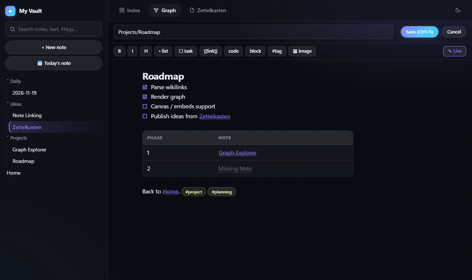
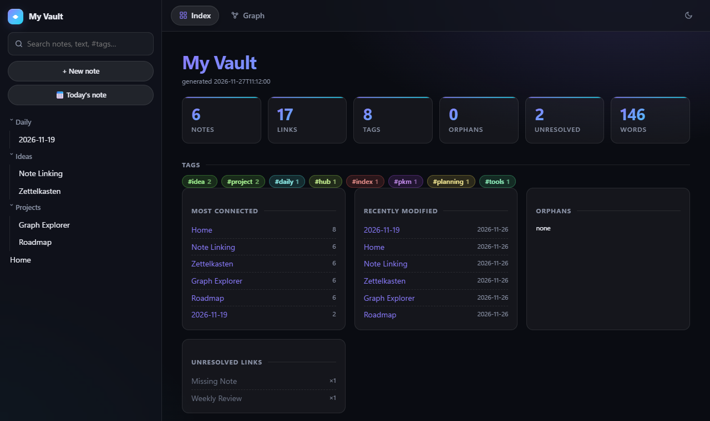
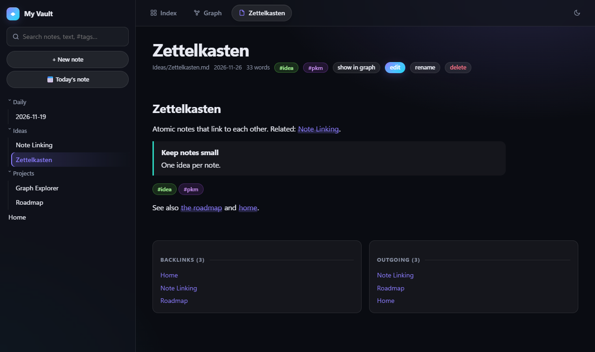
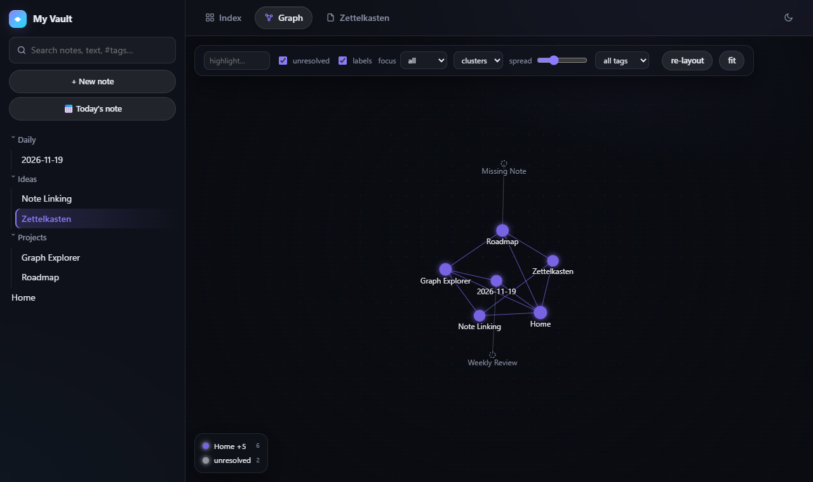

# fastobsidian

**Your [Obsidian](https://obsidian.md) vault, open in a blink.** A native explorer and editor for the same Markdown
files Obsidian uses, plus a built-in MCP server so AI agents can search, read and write your notes.

- **Instant**: 40,000 notes open in about 0.2 s (0.9 s on the very first start), with search, graph and backlinks ready.
- **Native and small**: one 4 MB program, no installer, no Electron, no account, no network calls. It uses the
  system's web view (WebView2 on Windows, WebKit on macOS and Linux).
- **AI-ready**: `fastobsidian VAULT --mcp` gives agents search, read, write/append, index, backlinks, rename and delete
  over stdio.
- **Same files, no lock-in**: it reads and writes the vault in place, follows Obsidian's daily-note, attachment and
  theme settings, and picks up changes made in Obsidian within a second.



| Index | Note | Graph |
|---|---|---|
|  |  |  |

### Speed

Measured on a vault of 40,000 notes (about 2 KB and 40 links each) on a 16-thread Windows 11 PC, release build:

| | time to index |
|---|---|
| first start (every note read and parsed, on all cores) | 0.9 s |
| later starts (on-disk cache, only changed notes re-read) | 0.2 s |
| 1.0.0, for comparison | 8.2 s |

What is left on a first start is mostly Windows opening 40,000 files. After an edit only the changed notes are read again.

### Download

Windows: the single `.exe` from [Releases](https://github.com/pakkio/fastobsidian/releases). It is not code-signed,
so SmartScreen may warn on first launch ("More info" > "Run anyway"); compare it with the release's `SHA256SUMS`.
macOS and Linux: build from source (below). The app window is started and screenshotted on Windows, macOS and Linux
in CI on every push; on Linux it needs a desktop session (the D-Bus session bus every desktop provides).


## Features

- **Index** – stats, tag cloud, most connected / recently modified notes, orphans, unresolved links, sortable A–Z table
- **Graph** – force-directed canvas: pan, zoom, drag, hover highlight, click to open, focus on a note (1–3 hops), colour by cluster or folder, filter by tag, spread slider, unresolved links as ghost nodes
- **Search** – folder tree plus full-text search with snippets, ranked by name, alias, tag, then body; click a tag to filter
- **Notes** – rendered markdown (headings, lists, tasks, tables, code, callouts, highlights, tags), built-in **Mermaid** diagrams (flowchart, sequence, state, class, ER, pie, mindmap) and **LaTeX** math (`$…$` and `$$…$$` via native MathML), backlinks and outgoing links
- **Slides** – present any note as a keyboard-navigated slide deck split on `---` (`slides` button or `Alt+P`), including images, Mermaid diagrams and LaTeX math
- **Navigation** – both `[[wikilinks]]` (with `#headings`, `|display` text, and frontmatter `aliases` as link targets) and standard `[text](path/note.md)` links, relative or vault-root
- **Focus mode** – Ctrl+F on a note hides the columns and goes full screen; press again (or Esc) to restore them
- **Table of contents** – clickable per-note TOC that tracks your scroll position
- **Theme** – glass-style UI with a light/dark toggle (follows the system by default, choice is remembered);
  `--theme` applies the vault's own Obsidian theme and enabled CSS snippets instead
- **Large vaults** – parallel, incremental index with an on-disk cache: 40,000 notes open in about 0.2 s (0.9 s the first time); a small splash with a progress bar appears only when loading is slow
- **Live refresh** – notes edited outside the app (e.g. in Obsidian) update in the open window within about a second
- **Editing** – create, edit, rename and delete notes in a live editor (every line formatted, the line you edit shown as markdown) or a split source + preview editor
- **Daily notes** – "Today's note" (Alt+D) opens or creates today's note, following Obsidian's Daily Notes settings and template
- **Images** – paste, drop or pick images and other media; they are saved in the vault's attachment folder and embedded as `![[…]]`
- **Vault switching** – Ctrl+O opens another vault (native folder dialog) without restarting
- **MCP server** – `--mcp` exposes search, read, write/append, index, backlinks, rename and delete to AI agents over stdio

## Build and run

Requires a recent stable [Rust](https://rustup.rs). On Linux also the WebKitGTK development packages
(Debian/Ubuntu: `sudo apt install libwebkit2gtk-4.1-dev libgtk-3-dev`). Windows 10/11 already has WebView2.

```bash
cargo build --release            # -> target/release/fastobsidian(.exe), a single file

fastobsidian /path/to/vault      # open the vault in the app window
fastobsidian                     # no vault: a folder dialog asks for one
```

The binary can be copied anywhere: the page is built into it. Other modes of the same program:

```bash
fastobsidian /path/to/vault --serve            # serve at http://127.0.0.1:8765/ for any browser (headless)
fastobsidian /path/to/vault -o explorer.html   # write a self-contained read-only page
fastobsidian /path/to/vault --mcp              # MCP server on stdio
```

Options: `--theme` (use the vault's Obsidian theme, see below), `--no-cache` (no index cache), `--watch SECONDS` (how often the vault is checked for
outside changes while a window or page is open, default 1; `0` turns it off), `--port N` (for `--serve`, default 8765),
`-o FILE` (static output), `--help`, `--version`. Try it with the bundled `sample-vault/`.

### How the window works

The app starts the same local server as `--serve` on `127.0.0.1` (port 47615, or a free one if that is taken) and shows
it in a window with the system web view. The fixed port keeps the page's origin the same between launches, so the
light/dark choice is remembered. Web and mail links open in your default browser, attachments (PDF, images, …) in their
own app. Closing the window with unsaved editor text asks first. The web view keeps its data in
`%LOCALAPPDATA%\fastobsidian` (Windows), `~/Library/Application Support/fastobsidian` (macOS) or
`~/.local/share/fastobsidian` (Linux).

## Obsidian themes and snippets

With `--theme`, the theme and CSS snippets enabled in `<vault>/.obsidian/appearance.json` are added to the page
(`.obsidian/themes/<Name>/theme.css` and `.obsidian/snippets/<name>.css`), and the explorer's colours follow the theme's
Obsidian variables (`--background-primary`, `--text-normal`, `--interactive-accent`, …). The light/dark toggle still works,
and its default comes from Obsidian's base theme. Only colours are mapped: a theme's layout rules target Obsidian's own
interface, so they mostly have no effect here. A theme can load fonts or images from the internet, so with `--theme` the
page may make network requests. It is off by default.

## Live refresh

An open window or page listens on `/api/events`, and the vault is checked every `--watch` seconds while one is open
(no checks when none is). When something changes on disk, the index, sidebar and graph reload and the open note is
re-rendered at the same scroll position. In the editor, a note without local changes takes the new text; with unsaved
changes, your text is kept and a warning says the file changed on disk (saving would be refused anyway).

## Index cache

The app window and `--serve` keep the parsed notes in a cache file, one per vault, in `%LOCALAPPDATA%\fastobsidian\index-cache`
(Windows), `~/Library/Application Support/fastobsidian/index-cache` (macOS) or `~/.cache/fastobsidian/index-cache`
(Linux). On the next start only notes whose modification time or size changed are read again: 40,000 notes open in
about 0.2 s instead of 0.9 s. An entry is used only while the file still matches it, and a cache from another version
or a damaged one is ignored, so deleting the folder is always safe. The cache holds the notes' text, like the vault.

## MCP server (for AI agents)

`fastobsidian /path/to/vault --mcp` speaks MCP over stdio. Tools: `search` (ranked: name > alias > tag > body, optional `tag`),
`read`, `write` (`append` default, `overwrite`, `create`; `tags`/`aliases` become frontmatter on new notes), `index`, `backlinks`, `rename`, `delete` (to `.trash`).

```json
{ "mcpServers": { "vault": { "command": "/path/to/fastobsidian", "args": ["/path/to/vault", "--mcp"] } } }
```

Frontmatter `aliases` also resolve `[[alias]]` links.

## Editing

Each note has **edit**, **rename** and **delete** buttons, and the sidebar has **+ New note**
(path like `Folder/Name`). Ctrl+S saves; Ctrl+O switches to another vault; a toolbar inserts bold, italic, headings, lists, tasks, `[[links]]`, code and tags.

- **Live editor** (default; the toolbar's Live / Source button switches to source + preview, and the choice is
  remembered): every line is rendered; click a line to edit its markdown, with the caret where you clicked (also
  inside bold text or a link's display text). Clicking a Mermaid diagram or LaTeX math block edits its source with a
  live preview underneath (toolbar buttons `∑ math` and `◇ mermaid` insert templates). Enter continues lists,
  numbered lists and tasks (on an empty item it outdents, then ends the list); Tab / Shift+Tab indent and outdent a
  list item. In quotes and callouts Enter keeps the `>` prefix, and Enter on an empty quote line ends the quote. In
  tables Tab and Shift+Tab move between cells and Enter adds a row. Backspace at the start of a line joins it to the
  one above, arrow keys move between lines, Esc stops editing. Click a task's box to tick it; Ctrl+click follows a link.
- **Today's note** (sidebar button or Alt+D): opens today's daily note in the editor, creating it if needed, with the
  folder, date format and template from `.obsidian/daily-notes.json` (`{{title}}`, `{{date}}`, `{{time}}`,
  `{{date:FORMAT}}` are filled in). Without settings it is `YYYY-MM-DD.md` at the top of the vault.
- **Images and media**: paste a screenshot, drop files on the editor or use the image button. Files go to the folder
  set as "attachmentFolderPath" in `.obsidian/app.json` (vault root, the note's folder, or a subfolder of it), are never
  overwritten (`name 1.png`), and `![[name.png]]` is inserted at the caret. Pasted images are named like Obsidian's
  (`Pasted image 20261127092201.png`).

- **Delete is recoverable**: files move to `<vault>/.trash/`.
- **Rename updates links**: `[[wikilinks]]` and markdown `[text](x.md)` links in other notes are repointed
  (markdown links are rewritten relative to each note; a moved note's own relative links are fixed too).
  Each note keeps its line endings when its links are rewritten.
- **Conflict check**: saving is refused if the file changed on disk since you opened it.
- Saving from the editor writes LF line endings.

## Security

The server binds to `127.0.0.1` only, rejects unexpected `Host`/`Origin` headers, requires a custom header on writes,
and only touches `.md` files inside the vault (paths with `..` or dot-folders are refused).
It has no authentication, so do not expose it on a network.

Symlinks and Windows junctions are never followed: linked files and folders are left out of the index, and reads,
writes, renames and attachment requests through a link are refused, so a link inside the vault cannot redirect a write
to a file elsewhere. (The check runs just before each file operation; it is not atomic.) Notes over 32 MiB are left out
of the index and refused by read and write (`MAX_NOTE_BYTES`).

## Notes

- Folders starting with `.` (e.g. `.obsidian`, `.trash`) are ignored.
- Attachments (images, PDF, audio, video) are detected and resolved by the index; the file type list is `MEDIA_EXT` in `src/vault.rs`.
- `explorer.html` embeds your vault's content; it is gitignored by default, so do not commit or share it unintentionally.

## Tests

```bash
cargo test                                         # index, parsing, note operations, server, MCP
cd e2e && npm ci && npx playwright install && npx playwright test   # the page in Chromium and WebKit
```

The browser tests (`e2e/`) start `fastobsidian --serve` on a copy of `sample-vault/` and check the index, search, note
view, graph and the live editor (lists, quotes, tables, clicks, tasks, image paste, today's note). With Edge installed,
`PW_CHANNEL=msedge npx playwright test --project=chromium` runs them without downloading a browser.
GitHub Actions runs `cargo test` and the browser tests on Windows, macOS and Linux, and starts the real app window on
all three, keeping a screenshot of each run. `node e2e/screenshots.js` regenerates the images in `docs/`.

## Code signing

Release builds are not signed yet. Options for an open-source project: [SignPath](https://signpath.org) (free for
OSS, signs in CI), Azure Trusted Signing (low monthly cost, needs an identity check), or a standard code-signing
certificate. Each needs the maintainer's own account, so it is not set up in this repository.

## Files

| File | Purpose |
|---|---|
| `src/main.rs`, `src/gui.rs` | Command line and the app window |
| `src/vault.rs` | Parsing, incremental index, search |
| `src/ops.rs` | Safe paths, read/save/create/rename (link rewriting)/trash |
| `src/server.rs`, `src/page.rs`, `src/mcp.rs` | Local server and live events, page and themes, MCP server |
| `explorer_template.html` | UI (index, graph, note view, editor), built into the binary |
| `sample-vault/` | Demo notes |
| `build.rs`, `src/icon.rs` | The app icon, drawn in code and embedded in the Windows .exe |
| `src/cache.rs`, `src/daily.rs` | Index cache; daily notes and attachments |
| `tests/` | `cargo test` |
| `e2e/` | Browser tests (Playwright) and the README screenshot script |
| `docs/` | README images |

## License

MIT, see [LICENSE](LICENSE).
